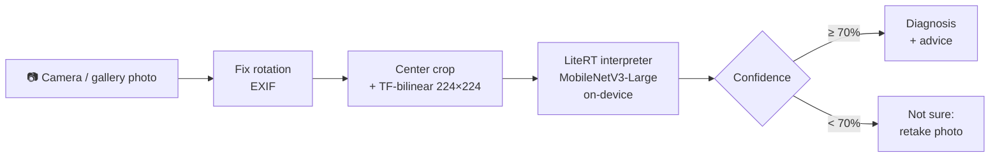

# BeanDoc — Offline Bean Leaf Disease Detection on Android

**Status: v1 feature-complete; awaiting real-phone testing and agronomist review of the advice text**

An Android app that lets a farmer **take a photo of a bean leaf and instantly see whether it has angular leaf spot, bean rust, or is healthy**, with practical advice on what to do next. Everything runs **on the phone, fully offline**, because many bean-growing areas have weak or no mobile data.

This repository covers the **AI engineering and deployment** part of the project: taking a trained model and turning it into a reliable, usable product on low-end devices.

🧠 Model training and evaluation: **[Bean-Disease-Classification](https://github.com/majeedar/Bean-Disease-Classification-with-MobileNet-Transformer-Architecture)**

| Home | Camera | Result | Not sure | Photo tips | Camera permission |
|---|---|---|---|---|---|
|  |  |  |  |  |  |

*Screenshots from the Android emulator (its camera shows a virtual room). Replace them with real-phone screenshots before release.*

---

## How it works



| Component | Choice |
|---|---|
| Model | MobileNetV3-Large, fine-tuned on the iBean dataset — 97.7% test accuracy in Python, **98.4% (126/128) through the app pipeline on Android**, 3.3 MB |
| On-device runtime | LiteRT 1.4.2 (formerly TensorFlow Lite), CPU / XNNPACK, 16 KB page-aligned native libraries |
| App | Kotlin, Jetpack Compose, Material 3, CameraX, MVVM |
| Min Android version | 7.0 (API 24); compiled and targeted against API 37 |
| Network access | **None**: the only permission is `CAMERA`; no analytics, no Play Services |
| APK size | ~8.8 MB (release, ARM only) |
| Speed | ~70 ms per photo (decode + preprocessing + inference) on an emulator |

---

## Model contract

| | |
|---|---|
| File | `app/src/main/assets/bean_model.tflite` (dynamic-range quantized) |
| Input | `float32[1, 224, 224, 3]`, RGB, **raw pixel values 0–255**; the model handles its own normalisation |
| Output | `float32[1, 3]` softmax probabilities |
| Labels (`labels.txt`, in output order) | `angular_leaf_spot`, `bean_rust`, `healthy` |

### Parity with Python

A **parity test** (`app/src/androidTest/.../ParityTest.kt`) runs 18 images, including a rotated (EXIF) and a non-square synthetic image per class, through the app's real pipeline and compares with the Python reference from `tools/make_parity_set.py`:

- **Model input** matches Python to within 0.001 (strict). Android's JPEG decoding is bit-identical to PIL's; the 224×224 resize is done in Kotlin with exactly `tf.image.resize`'s bilinear maths, because Android's `createScaledBitmap` samples differently and shifted predictions by up to 0.03.
- **Labels** match on every image.
- **Probabilities** match within ±0.10. The quantized model gives slightly different outputs on different runtimes even for byte-identical input (TF 2.17 with vs without XNNPACK differs by up to 0.09), so a tighter tolerance is not achievable. Details in [AGENTS.md](AGENTS.md#82-instrumented-tests-androidtest--model-parity).

---

## Features

### v1
- [x] Camera screen with a leaf guide frame that shows exactly what the model sees (CameraX), flash, tap to focus
- [x] Pick a photo from the gallery (system photo picker, no storage permission)
- [x] On-device inference in well under a second
- [x] Result screen: diagnosis with colour + icon + text, confidence in plain words, and advice
- [x] "Not sure, please retake" below 70% confidence instead of a guess
- [x] Photo tips screen
- [x] Works in airplane mode; light and dark theme; accessible (icons + text, scalable fonts, 48 dp targets)
- [x] Parity test against the Python model

### Planned
- Scan history (stored locally)
- Local language translations and read-aloud results for low-literacy users
- Live classification on the camera preview
- "Not a bean leaf" class and more diseases (needs a retrained model; the app is built so a new model only means swapping two files)

---

## Known limitations

- **Non-leaf photos are often classified confidently.** The model only knows three classes, so it always picks one of them. On the emulator, a photo of a room was shown as "Bean rust · Very likely (86%)", and synthetic images (noise, grey wall, soil, skin) came out as "Healthy" at 73–95%. The 70% "Not sure" threshold does not catch these. Fixing this needs a retrained model with a "not a bean leaf" class (see [Updating the model](#updating-the-model)). Until then, the photo tips and the disclaimer are the safeguard.
- **The advice text is general guidance** and must be reviewed by a local agronomist or extension officer before public release.
- Tested on emulators only so far (API 36, x86_64, plus the ARM release build via translation). See the manual checklist below.

---

## Repository layout

```
├── AGENTS.md                  # full build spec: model contract, features, advice text, tests, definition of done
├── CLAUDE.md                  # entry point for Claude Code (imports AGENTS.md)
├── app/
│   └── src/
│       ├── main/assets/       # bean_model.tflite + labels.txt
│       ├── main/java/…/ml/    # ImageLoader, ImagePreprocessor, BeanClassifier
│       ├── test/              # JVM unit tests
│       └── androidTest/       # parity test + parity images/expected.json
├── docs/
│   ├── claude-code-prompts.md # step-by-step prompts used to build the app
│   └── screenshots/
└── tools/
    └── make_parity_set.py     # generates parity test images + expected outputs from Python
```

---

## Building

### Prerequisites
- [Android Studio](https://developer.android.com/studio) (latest stable): provides the Android SDK, emulator and JDK 21
- Gradle comes with the wrapper; no separate install needed

On Windows, point Gradle at Android Studio's JDK if `java` on your PATH is older:

```bash
# Git Bash
export JAVA_HOME="/c/Program Files/Android/Android Studio/jbr"
```

### Commands
```bash
./gradlew assembleDebug             # debug APK (all ABIs, runs on emulators)
./gradlew test                      # JVM unit tests (28)
./gradlew connectedAndroidTest      # parity test (needs a device or emulator)
./gradlew assembleRelease           # release APK (ARM only, shrunk with R8)
```

Use `gradlew.bat` from `cmd`/PowerShell. The release build is unsigned until a signing key is configured.

---

## Download website

The APK is published on a small static site with a direct link (`https://<domain>/beandoc.apk`, always the latest version) and a downloadable QR code for posters and flyers. Everything needed is in this repo:

| File | Purpose |
|---|---|
| [deploy/README.md](deploy/README.md) | Step-by-step: signing key, server setup, releasing a version |
| `site/index.template.html` | The page (no JavaScript, analytics or external resources; works on small phones, light/dark) |
| `tools/build_site.py` | Copies the signed APK, generates the QR code locally, fills in version, size and SHA-256 → `site/public/` |
| `deploy/Caddyfile` | HTTPS, APK MIME type, caching, security headers |
| `deploy/deploy.sh` | Uploads `site/public/` to the server with rsync |

---

## Updating the model

1. Retrain/export in the training repo (keep the input contract: 224×224, raw 0–255 RGB).
2. Replace `bean_model.tflite` and `labels.txt` in `app/src/main/assets/`.
3. Add advice strings for any new label in `strings.xml`, following the `<label>_title`, `<label>_what_you_see`, … naming convention. A label without strings still works and shows a generic message.
4. Regenerate parity data and re-run the parity test:
   ```bash
   python tools/make_parity_set.py --data-dir <training folder> --out app/src/androidTest/assets/parity
   ./gradlew connectedAndroidTest
   ```

No Kotlin changes are needed as long as the input contract stays the same.

---

## Manual checks before release

- [ ] Install on a real phone; portrait and landscape photos of the same leaf give the same result
- [ ] Run on the cheapest phone available (2 GB RAM, Android 7–8): no out-of-memory errors; check the scan time in `adb logcat -s ScanViewModel`
- [ ] Photos of hands, soil and walls: record what the app says (see Known limitations)
- [ ] Airplane mode on the real phone
- [ ] Agronomist / extension officer review of the advice text in `app/src/main/res/values/strings.xml`
- [ ] Replace emulator screenshots with real-phone screenshots

---

## Disclaimer

BeanDoc gives general guidance and can make mistakes. Advice text must be reviewed by a local agronomist or extension officer before public release. If many plants are affected, farmers should contact their local extension service.

---

## Author

**Majeed Abdul-Razak** · [GitHub](https://github.com/majeedar)
