# Phase 2: BeanDoc — deploying a bean leaf disease classifier to low-end Android phones, fully offline


A farmer takes a photo of a bean leaf and, in well under a second, sees whether it has **angular leaf spot**, **bean rust** or is **healthy**, how sure the app is, and what to do next. Everything runs on the phone, with no internet connection, because many bean-growing areas have weak or no mobile data.

This repository is **Phase 2 (deployment)** of the project: it takes the trained model and turns it into a reliable product on cheap phones, with a verified preprocessing pipeline, a tested app, a signed release and a self-hosted download site.

> **Phase 1: model training and evaluation** → [Bean-Disease-Classification-with-MobileNet-Transformer-Architecture](https://github.com/majeedar/Bean-Disease-Classification-with-MobileNet-Transformer-Architecture)
> **Phase 2: deployment** → this repository

| Angular leaf spot | Bean rust | Healthy | Not sure (retake) |
|:---:|:---:|:---:|:---:|
| 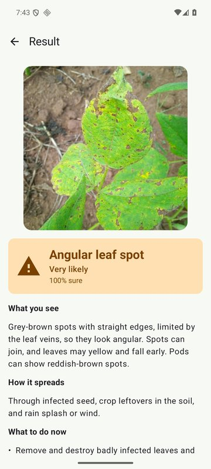 | 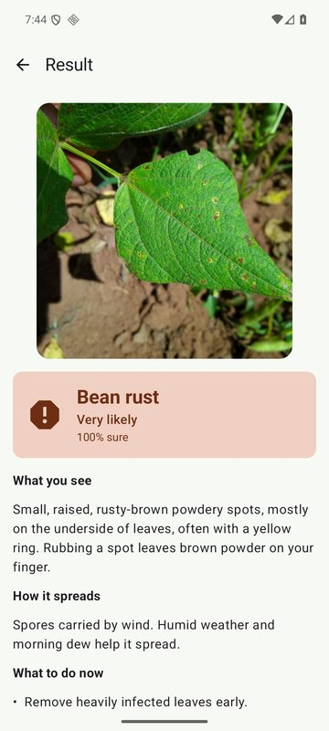 | 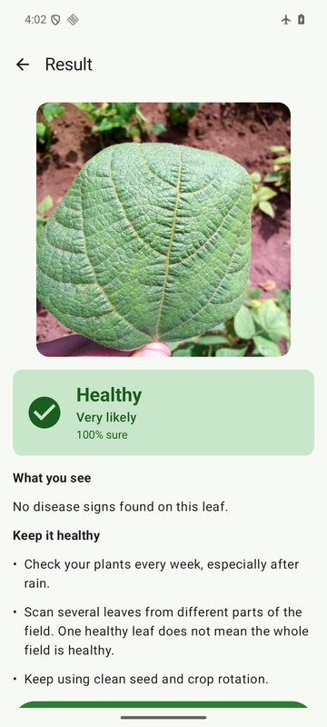 | 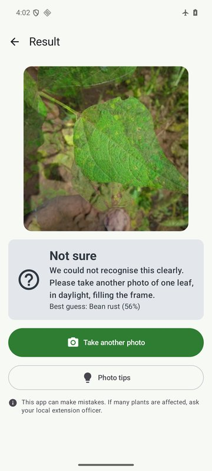 |

---

## Highlights

| | |
|---|---|
| **On-device accuracy** | **126/128 (98.4%)** on the held-out test set, through the full app pipeline (decode → EXIF → crop → resize → inference). Python TFLite: 125/128. |
| **Preprocessing parity** | Model input on Android matches the Python reference to **< 0.001** per value, proven by an instrumented test on 18 images, including synthetic rotated and non-square photos. |
| **Speed** | ~70 ms per photo end to end on an x86_64 emulator (target: < 1 s on a mid-range phone). |
| **Size** | **8.8 MB** APK (down from 24.6 MB) by choosing a lean runtime, ARM-only native libraries and R8 shrinking. |
| **Privacy** | Only permission: `CAMERA`. No internet permission, no analytics, no Play Services; verified in the merged release manifest. |
| **Uncertainty** | Below 70% confidence the app says **"Not sure"** and asks for a better photo instead of presenting a guess as a diagnosis. |
| **Distribution** | Signed APK on a static download page with a direct link and a printable QR code, behind nginx + Let's Encrypt on a Hetzner VM. |
| **Tests** | 28 JVM unit tests (incl. resize maths against TensorFlow reference values) + instrumented parity test. |

---

## Contents

1. [Problem and constraints](#1-problem-and-constraints)
2. [System overview](#2-system-overview)
3. [The on-device inference pipeline](#3-the-on-device-inference-pipeline)
4. [Engineering challenges and how they were solved](#4-engineering-challenges-and-how-they-were-solved)
5. [Results](#5-results)
6. [Screenshots](#6-screenshots)
7. [Distribution: signed APK and download website](#7-distribution-signed-apk-and-download-website)
8. [Testing strategy](#8-testing-strategy)
9. [Known limitations](#9-known-limitations)
10. [Build, run and update the model](#10-build-run-and-update-the-model)
11. [Repository layout](#11-repository-layout)
12. [How this was built](#12-how-this-was-built)

---

## 1. Problem and constraints

| Constraint | Consequence for the design |
|---|---|
| Rural users, weak or no mobile data | All inference on-device; zero network calls; small download |
| Cheap phones (2–3 GB RAM, Android 7+) | 3.3 MB quantized MobileNetV3; memory-mapped model; downsampled decoding; one interpreter for the whole app |
| Mixed literacy | Icons + colour + short text for every result; confidence in words ("Very likely", "Likely", "Not sure"); scalable fonts |
| A wrong confident answer is worse than no answer | Explicit "Not sure" path below 0.70; disclaimer; advice reviewed by an agronomist before release |
| Model trained in Python, deployed on Android | Preprocessing must match training exactly, proven by a parity test, not assumed |

---

## 2. System overview

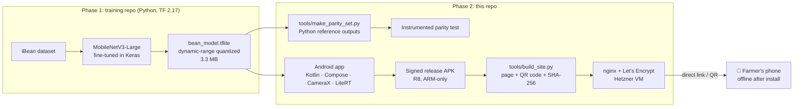

### Model contract

| | |
|---|---|
| Architecture | MobileNetV3-Large, ImageNet-pretrained, fine-tuned on iBean (3 classes) |
| File | `app/src/main/assets/bean_model.tflite`, dynamic-range quantized (int8 weights, float I/O), stored uncompressed in the APK so it can be memory-mapped |
| Input | `float32[1, 224, 224, 3]`, NHWC, RGB, **raw 0–255** (normalisation is inside the model) |
| Output | `float32[1, 3]` softmax, in the order of `labels.txt`: `angular_leaf_spot`, `bean_rust`, `healthy` |

`BeanClassifier` validates the input and output shapes against `labels.txt` at load time, so a mismatched model fails fast with a clear message instead of producing garbage.

---

## 3. The on-device inference pipeline

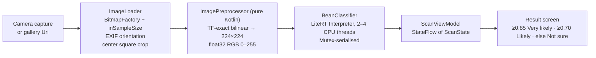

| Stage | Design choice | Why |
|---|---|---|
| Capture | CameraX writes a JPEG to the cache; gallery uses the system photo picker | Both arrive as a `Uri` → one code path, one test; no storage permission |
| Decode | `BitmapFactory` with power-of-two `inSampleSize`, keeping the short side ≥ 448 px | Avoids OOM on cheap phones; keeps the last resize step close to the scale the model was trained on; works on API 24 (`ImageDecoder` needs 28) |
| Orientation | `androidx.exifinterface`, all 8 EXIF orientations | Camera photos are often stored sideways |
| Crop | Center square, same integer maths as the Python reference | Matches how a farmer frames a single leaf |
| Resize | Exact Kotlin port of TensorFlow's `compute_interpolation_weights` (half-pixel centers), output kept as floats | Model input is provably identical to training-time preprocessing; see 4.1 |
| Inference | One app-scoped `Interpreter`, memory-mapped model, `Mutex` around `run()` | Interpreter is not thread-safe; never closed while a scan may be running |
| UI state | `ScanState` (`Idle` / `Analyzing` / `Result` / `Error`) in one ViewModel scoped to the nav graph | Survives rotation; double taps ignored; after process death the result screen returns home instead of crashing |

---

## 4. Engineering challenges and how they were solved

### 4.1 Proving the Android pipeline matches Python

The most common way an on-device model silently degrades is a preprocessing mismatch: wrong normalisation, swapped channels, a sideways photo, a different resampler. Instead of assuming parity, it is measured.

**What was checked:**
- The training notebook loads images with `keras.utils.image_dataset_from_directory(image_size=(224, 224))`, i.e. TF bilinear **without antialiasing** and **without cropping**. The Python reference script and the app were aligned to this (the PIL snippet in the training README uses a different filter and was deliberately not used as the reference).
- JPEG decoding: Android's decoder output was dumped from the device and compared with PIL: **bit-identical** (max difference 0).
- Resizing: Android's `Bitmap.createScaledBitmap` is implementation-defined (Skia) and not guaranteed to use TF's half-pixel sample positions. It was replaced with an exact port of TF's bilinear weights, unit-tested against values produced by TensorFlow 2.17 for odd, even and upscaling cases.

**Result:** the parity test compares the model input on a 16-px grid against Python: max difference **0.0005**, which is the JSON rounding of the reference.

### 4.2 A quantized model gives different answers on different runtimes, even for identical input

After preprocessing was fixed, two images still differed from Python by up to 0.05 in probability. To isolate the cause, Python's exact input tensor was saved and fed byte-for-byte into the Android interpreter:

| Image | TF 2.17 Python + XNNPACK | TF 2.17 Python, no XNNPACK | LiteRT on Android (same input bytes) |
|---|---:|---:|---:|
| `bean_rust_test.11`: P(bean rust) | 0.825 | **0.911** | 0.778 |
| `angular_leaf_spot_test.10`: P(angular leaf spot) | 0.984 | 0.982 | 0.952 |

Even inside Python, switching the CPU backend moves a borderline prediction by 0.09. Dynamic-range quantization quantizes activations on the fly, and each kernel library does it slightly differently. The gap is not an app bug, so the test was redesigned rather than loosened blindly:

- **Strict** where the app is in control: model input within ±0.01 of Python.
- **Realistic** where the runtime is in control: same label, probabilities within ±0.10.

### 4.3 Test data that cannot catch the bugs that matter

The iBean test images are all 500×500 and have no EXIF data, so a parity test built from them would never exercise rotation or cropping, the two steps most likely to break on real phones. `make_parity_set.py` therefore also generates, per class:

- a **wide** copy (reflect-padded left/right): a correct center crop recovers the original exactly;
- an **EXIF-6** copy: pixels stored sideways with an orientation tag, as phone cameras do.

If only these fail, the bug is in rotation or crop; if all images fail, it is resize, channel order or normalisation.

### 4.4 Choosing the runtime: smaller, fewer permissions, same results

LiteRT 2.3.2 was the newest version, but it pulled in Google Play Services, WorkManager, Room and an **alpha** model-download library, plus `FOREGROUND_SERVICE`, `WAKE_LOCK`, `ACCESS_NETWORK_STATE` and `RECEIVE_BOOT_COMPLETED` permissions: all for features an offline app does not use.

| | LiteRT 2.3.2 | LiteRT 1.4.2 (chosen) |
|---|---|---|
| Extra dependencies | Play Services, WorkManager, Room, alpha `ai-delivery` | none |
| Extra permissions | 4 | 0 |
| Release APK | 24.6 MB | **8.8 MB** (with ARM-only, compressed native libs) |
| 16 KB page alignment (Android 15+) | ✓ | ✓ (verified by parsing the ELF `PT_LOAD` alignment of every `.so`) |
| Parity results | identical | identical |

A permission added by CameraX's media dependency (`ACCESS_NETWORK_STATE`) is explicitly removed in the manifest, and the merged release manifest is checked to contain only `CAMERA`.

### 4.5 The viewfinder must show what the model sees

A full-screen `FILL_CENTER` preview crops the camera image to the screen's aspect ratio, so a leaf that fills an on-screen guide would occupy only about half of the square the model actually receives. The preview uses `FIT_CENTER` (letterboxed 4:3), and the guide square is computed to cover exactly the center crop `ImageLoader` takes.

### 4.6 Saying "I don't know"

| Top probability | Shown as |
|---|---|
| ≥ 0.85 | **Very likely** + diagnosis and advice |
| 0.70–0.85 | **Likely** + diagnosis and advice |
| < 0.70 | **Not sure**: retake advice instead of a diagnosis; best guess in small text |

On the test set, one of the two misclassified images (0.68) falls into "Not sure", so the user would have been asked to retake the photo rather than shown the wrong disease.

---

## 5. Results

Measured on an Android 16 (API 36) x86_64 emulator; the release (ARM) build was also run through the emulator's ARM translation.

| Metric | Value |
|---|---|
| Test-set accuracy through the full app pipeline | **126/128 = 98.4%** |
| Python TFLite accuracy on the same 128 images | 125/128 = 97.7% |
| Misclassified | `angular_leaf_spot_test.14` → bean rust (0.68, shown as *Not sure*), `angular_leaf_spot_test.42` → bean rust (0.99) |
| Shown as "Not sure" | 3 of 128 |
| Parity set | 18 images (12 real + 6 synthetic): labels 18/18, model input max Δ 0.0005, probability max Δ 0.048 |
| Time per photo (decode + preprocess + inference) | ~70 ms average (emulator on a desktop CPU; real-phone timing pending) |
| Release APK | 8.8 MB, permissions: `CAMERA` only |

---

## 6. Screenshots

**App**

| Home | Camera with guide | Bean rust: *Likely* (78%) | Dark mode | Photo tips | Camera permission |
|:---:|:---:|:---:|:---:|:---:|:---:|
| 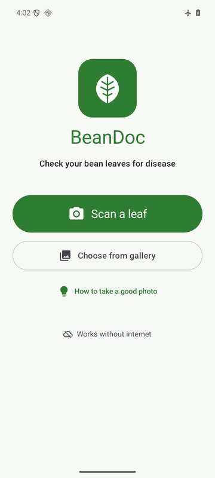 | 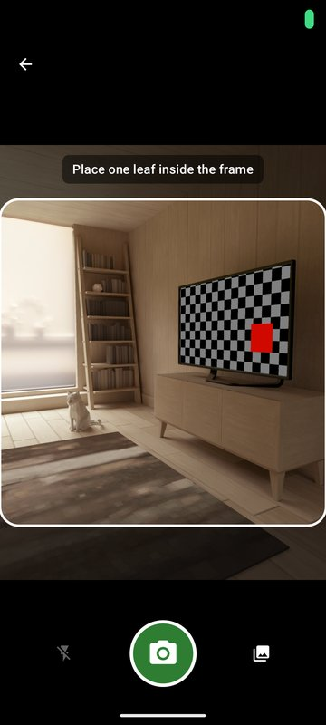 | 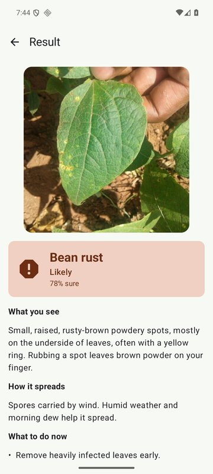 | 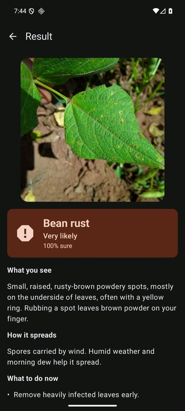 | 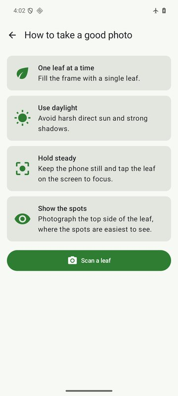 | 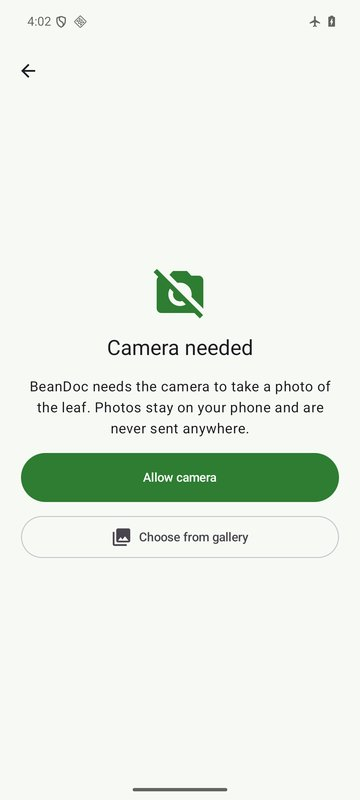 |

**Download website** (shown with a placeholder domain)

| Download | QR code and install steps |
|:---:|:---:|
| 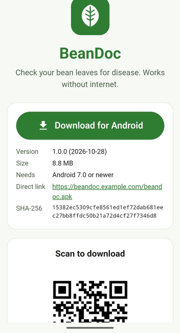 | 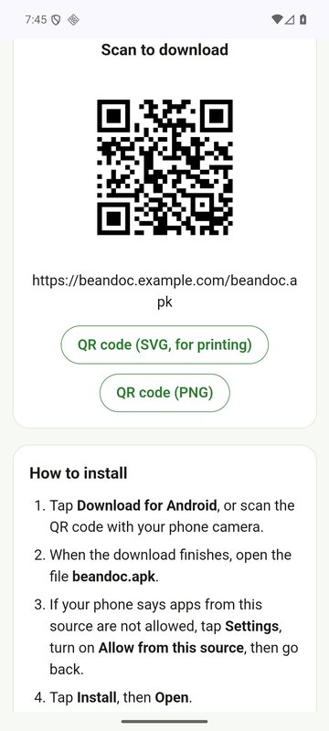 |

*Screenshots are from the Android emulator; its camera shows a virtual room. Leaf photos are from the iBean test set.*

---

## 7. Distribution: signed APK and download website

Farmers and extension officers get the app by scanning a QR code on a poster or opening a link; there is no app store dependency.

| Piece | Implementation |
|---|---|
| Signing | Release key kept outside the repo; read from `local.properties` or `BEANDOC_*` environment variables. Without a key the build is unsigned and the site generator refuses to publish it. |
| Site generator | [`tools/build_site.py`](tools/build_site.py): copies the APK as `beandoc.apk` (stable link) and `beandoc-<version>.apk`, generates the QR code **locally** (`segno`, no online QR service) as SVG for printing and PNG for sharing, fills in version, size and SHA-256. |
| Page | [`site/index.template.html`](site/index.template.html): one static page, no JavaScript, no analytics, no external fonts or CDNs; light/dark; readable on small phones; install steps for "unknown sources". |
| Server | Hetzner VM shared with other apps: static files behind the host's nginx ([`deploy/nginx-beandoc.conf`](deploy/nginx-beandoc.conf)) with a Let's Encrypt certificate from certbot. Correct APK MIME type, `no-cache` for the stable link, immutable caching for versioned files, strict CSP. A [Caddy](deploy/Caddyfile) config is included for a dedicated server. |
| Deploy | [`deploy/deploy.sh`](deploy/deploy.sh): uploads next to the live site and swaps it in with one rename, so visitors never see a half-uploaded page; older versioned APKs are kept. Server address and key live in a gitignored `deploy/deploy.env`. |

The QR code encodes the stable link, so printed posters keep working after updates. Details: [deploy/README.md](deploy/README.md).

---

## 8. Testing strategy

| Level | What | Where |
|---|---|---|
| JVM unit tests (28) | Confidence thresholds (0.85 / 0.70 boundaries); label parsing (CRLF, blanks, duplicates); argmax and probability-sum checks; RGB order and "no /255"; **bilinear resize vs. TensorFlow reference values**; crop and sample-size maths; advice lookup with fallback for unknown labels | `app/src/test` |
| Instrumented parity test | 18 images through the real `ImageLoader → ImagePreprocessor → BeanClassifier`, starting from a file `Uri` like gallery/camera photos: model input (strict), label, probabilities; prints a per-image table | `app/src/androidTest` |
| Release verification | Merged manifest permissions, APK size, R8 build actually running inference, airplane mode | manual, documented in `AGENTS.md` §8.3 |
| Manual UI checks | Camera permission denied → denied permanently → Settings → granted; rotation during analysis; process death; dark mode; 200% font size; landscape | emulator |

---

## 9. Known limitations

- **Photos that are not bean leaves are often classified confidently.** The model only knows three classes, so it always picks one: a photo of a room was shown as "Bean rust, Very likely (86%)", and synthetic noise / wall / soil / skin images came out as "Healthy" at 73–95%. The confidence threshold cannot fix this; a retrained model with a "not a bean leaf" class can. The app already handles a different number of labels without code changes (see below). Until then, the photo tips and the disclaimer are the safeguard.
- **The advice text is general guidance** and must be reviewed by a local agronomist or extension officer before wide release.
- **Tested on emulators so far**; real-device timing and memory on a 2 GB phone are still to be measured.

---

## 10. Build, run and update the model

**Prerequisites:** [Android Studio](https://developer.android.com/studio) (SDK, emulator, JDK 21). On Windows, point Gradle at Android Studio's JDK if an older Java is on the `PATH`:

```bash
export JAVA_HOME="/c/Program Files/Android/Android Studio/jbr"   # Git Bash
```

```bash
./gradlew assembleDebug           # debug APK (all ABIs, runs on emulators)
./gradlew installDebug            # install on a connected phone/emulator
./gradlew test                    # 28 JVM unit tests
./gradlew connectedAndroidTest    # parity test (device or emulator)
./gradlew assembleRelease         # release APK: R8, ARM-only, signed if a key is configured
```

**Updating the model** (e.g. adding a "not a bean leaf" class):

1. Export from the training repo, keeping the input contract (224×224, raw 0–255 RGB).
2. Replace `bean_model.tflite` and `labels.txt` in `app/src/main/assets/`.
3. Add advice strings following the `<label>_title`, `<label>_what_you_see`, … convention in `strings.xml`. A label without strings still works and shows a generic message.
4. Regenerate the parity set and re-run the test:
   ```bash
   python tools/make_parity_set.py --data-dir <training folder> --out app/src/androidTest/assets/parity
   ./gradlew connectedAndroidTest
   ```

No Kotlin changes are needed as long as the input contract stays the same.

---

## 11. Repository layout

```
├── app/src/main/
│   ├── assets/                     bean_model.tflite, labels.txt
│   ├── java/com/majeedar/beandoc/
│   │   ├── ml/                     ImageLoader, ImagePreprocessor, BeanClassifier, Prediction, Labels
│   │   ├── data/                   DiseaseInfo (advice lookup by label, with fallback)
│   │   ├── viewmodel/              ScanViewModel, ScanState
│   │   ├── ui/                     home, camera, result, tips, theme, navigation
│   │   └── BeanDocApp.kt           app-scoped classifier
│   └── res/values/strings.xml      all user-facing text, incl. disease advice (translatable)
├── app/src/test/                   JVM unit tests
├── app/src/androidTest/            parity test + parity images and expected.json
├── tools/
│   ├── make_parity_set.py          Python reference outputs (+ synthetic EXIF / non-square images)
│   └── build_site.py               download page, QR codes, checksums
├── site/                           page template and favicon
├── deploy/                         nginx and Caddy configs, deploy script, publishing guide
├── docs/screenshots/
├── AGENTS.md                       full engineering spec (model contract, features, tests, definition of done)
└── docs/claude-code-prompts.md     the phase-by-phase build plan
```

**Stack:** Kotlin 2.4 · Jetpack Compose (Material 3) · CameraX 1.6 · LiteRT 1.4.2 · Coroutines/StateFlow · Navigation Compose · AGP 9.4 · Gradle 9.8 · min SDK 24, target SDK 37 · Python 3.12 / TensorFlow 2.17 for tooling.

---

## 12. How this was built

The project was developed **spec-first** with an AI coding agent (Claude Code):

- [`AGENTS.md`](AGENTS.md) defines the model contract, preprocessing, features, advice content, testing and definition of done before any code was written; it was revised as measurements contradicted assumptions (resize method, parity tolerance, runtime choice).
- The app was built in small phases ([`docs/claude-code-prompts.md`](docs/claude-code-prompts.md)), each gated by `assembleDebug` + tests and committed separately, so every decision is traceable in the git history.
- Claims in this README come from measurements on the emulator and the Python reference, not from expectations.

---

## Disclaimer

BeanDoc gives general guidance and can make mistakes. The advice text must be reviewed by a local agronomist or extension officer before public release. If many plants are affected, farmers should contact their local extension service.

## Author

**Majeed Abdul-Razak** · [GitHub](https://github.com/majeedar)
