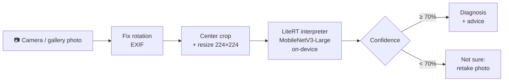

# BeanDoc — Offline Bean Leaf Disease Detection on Android

**Status: 🚧 in development**

An Android app that lets a farmer **take a photo of a bean leaf and instantly see whether it has angular leaf spot, bean rust, or is healthy**, with practical advice on what to do next. Everything runs **on the phone, fully offline**, because many bean-growing areas have weak or no mobile data.

This repository covers the **AI engineering and deployment** part of the project: taking a trained model and turning it into a reliable, usable product on low-end devices.

🧠 Model training and evaluation: **[Bean-Disease-Classification](https://github.com/majeedar/Bean-Disease-Classification-with-MobileNet-Transformer-Architecture)**

---

## How it works



| Component | Choice |
|---|---|
| Model | MobileNetV3-Large, fine-tuned on the iBean dataset — **97.7% test accuracy**, 3.3 MB |
| On-device runtime | LiteRT (formerly TensorFlow Lite), CPU with optional GPU delegate |
| App | Kotlin, Jetpack Compose, Material 3, CameraX, MVVM |
| Min Android version | 7.0 (API 24) |
| Network access | **None**: no internet permission, no analytics |

---

## Model contract

| | |
|---|---|
| File | `bean_model.tflite` (dynamic-range quantized) |
| Input | `float32[1, 224, 224, 3]`, RGB, **raw pixel values 0–255**; the model handles its own normalisation |
| Output | `float32[1, 3]` softmax probabilities |
| Labels (`labels.txt`, in output order) | `angular_leaf_spot`, `bean_rust`, `healthy` |

A **parity test** checks that the Android preprocessing + inference pipeline gives the same predictions as the Python reference, which catches the most common deployment bugs (wrong normalisation, rotated photos, swapped colour channels).

---

## Features

### v1 (in progress)
- [ ] Camera screen with leaf guide frame (CameraX)
- [ ] Pick a photo from the gallery
- [ ] On-device inference in under a second
- [ ] Result screen: diagnosis, confidence in plain words, and advice
- [ ] "Not sure, please retake" below 70% confidence instead of a guess
- [ ] Photo tips screen
- [ ] Works in airplane mode; light and dark theme; accessible (icons + text, scalable fonts)
- [ ] Parity test against the Python model

### Planned
- Scan history (stored locally)
- Local language translations and read-aloud results for low-literacy users
- Live classification on the camera preview
- "Not a bean leaf" class and more diseases (needs a retrained model; the app is built so a new model only means swapping two files)

---

## Repository layout

```
├── AGENTS.md                  # full build spec: model contract, features, advice text, tests, definition of done
├── CLAUDE.md                  # entry point for Claude Code (imports AGENTS.md)
├── model/
│   ├── bean_model.tflite      # trained model (from the training repo)
│   └── labels.txt
├── docs/
│   └── claude-code-prompts.md # step-by-step prompts to build the app with Claude Code
├── tools/
│   └── make_parity_set.py     # generates parity test images + expected outputs from Python
└── app/                       # Android project (created in phase 1)
```

---

## Getting started

### Prerequisites
- [Android Studio](https://developer.android.com/studio) (latest stable): provides the Android SDK, emulator and JDK
- [VS Code](https://code.visualstudio.com/) with the Claude Code extension
- A physical Android phone (recommended for camera testing) with USB debugging enabled
- Python with TensorFlow (only to regenerate the parity test data)

### Build the app with Claude Code
1. Clone this repo and open the folder in VS Code.
2. Make sure `model/bean_model.tflite` is present (copy it from the training repo's `export/` folder).
3. Open Claude Code and work through the phases in **[docs/claude-code-prompts.md](docs/claude-code-prompts.md)**, one at a time. Claude Code reads `CLAUDE.md` and `AGENTS.md` automatically, so it already knows the spec.
4. After each phase, build and run the app (Android Studio or `./gradlew installDebug`) and commit.

### Build manually
```bash
./gradlew assembleDebug        # build APK
./gradlew test                 # unit tests
./gradlew connectedAndroidTest # parity + instrumented tests (device/emulator required)
```

---

## Updating the model

1. Retrain/export in the training repo (keep the input contract: 224×224, raw 0–255 RGB).
2. Replace `bean_model.tflite` and `labels.txt` in `app/src/main/assets/`.
3. Add advice text for any new label in `strings.xml`.
4. Regenerate parity data with `tools/make_parity_set.py` and re-run the parity test.

No Kotlin changes are needed as long as the input contract stays the same.

---

## Disclaimer

BeanDoc gives general guidance and can make mistakes. Advice text must be reviewed by a local agronomist or extension officer before public release. If many plants are affected, farmers should contact their local extension service.

---

## Author

**Majeed Abdul-Razak** · [GitHub](https://github.com/majeedar)
